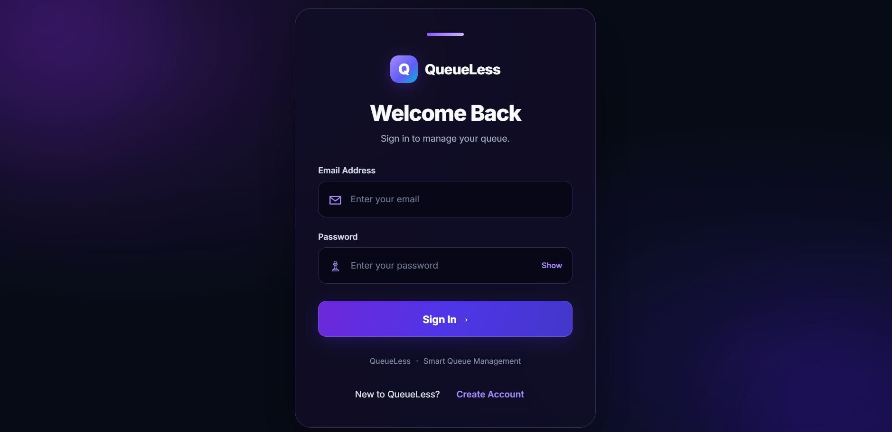
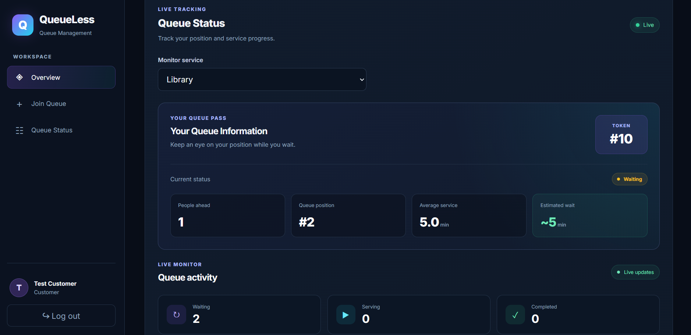
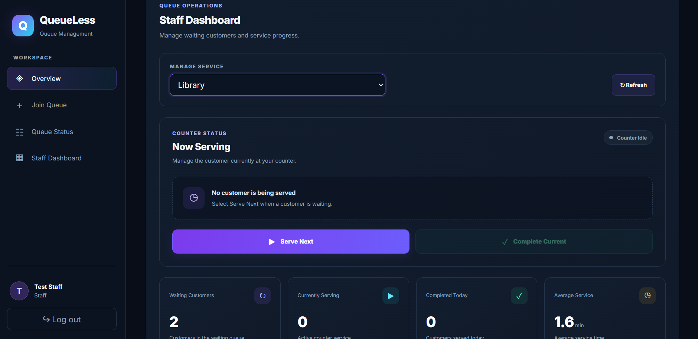
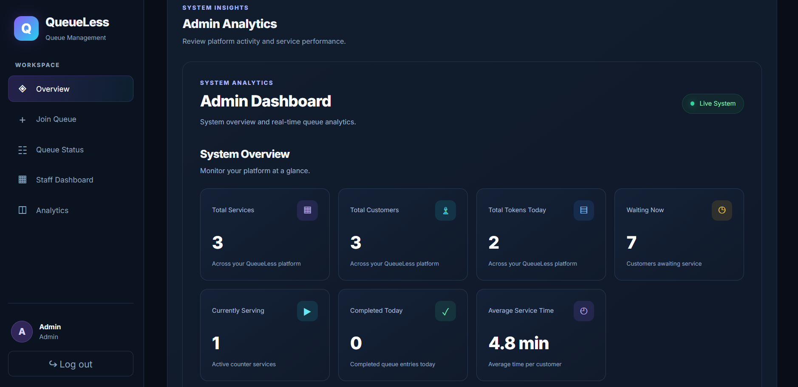
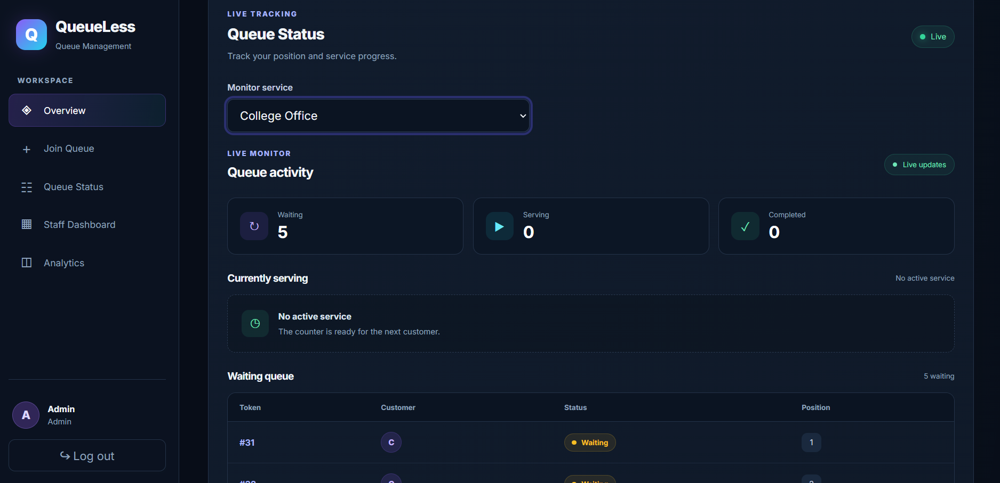

# QueueLess — Real-Time Queue Management System

QueueLess is a full-stack web application designed to simplify queue management. Customers can join service queues, track their token numbers, and receive real-time updates. Staff can manage queues, while administrators can monitor service performance through analytics.

## Live Demo

* **Frontend:** https://queueless-frontend-gdph.onrender.com
* **Backend API:** https://queueless-iwvf.onrender.com
* **GitHub Repository:** https://github.com/Atharva-143/QueueLess

> **Note:** The backend is an API service, so opening its base URL in a browser may not display a user interface.


## Features

- **Customer Dashboard:** Join queues, view token numbers, and track queue positions.
- **Real-Time Updates:** Receive automatic queue status updates using Socket.IO.
- **Staff Dashboard:** Serve the next customer and complete current service requests.
- **Admin Dashboard:** Monitor queue activity, service statistics, and completed entries.
- **Authentication:** JWT-based authentication with role-based access control.
- **Password Security:** Hash passwords using bcryptjs.
- **Input Validation:** Reject invalid user input.
- **Rate Limiting:** Limit excessive authentication and queue requests.
- **Database Integration:** Store user, service, and queue information in MySQL.

## Application Screenshots

### Login Page


### Customer Dashboard


### Staff Dashboard


### Admin Dashboard


### Real-Time Queue Status


## Technology Stack

**Frontend**
- React
- Vite
- JavaScript
- CSS

**Backend**
- Node.js
- Express.js
- Socket.IO
- MySQL
- JSON Web Tokens (JWT)
- bcryptjs

## Project Structure

```text
QueueLess/
├── backend/
│   ├── server.js
│   ├── package.json
│   └── .gitignore
└── frontend/
    ├── src/
    │   ├── components/
    │   ├── App.jsx
    │   └── main.jsx
    ├── package.json
    └── .gitignore
```

## Prerequisites

Install the following before running QueueLess:

- Node.js and npm
- MySQL Server
- Git

## Local Setup

### 1. Clone the Repository

```bash
git clone https://github.com/Atharva-143/QueueLess.git
cd QueueLess
```

### 2. Set Up the Database

1. Ensure that MySQL Server is running.
2. Open MySQL Workbench and connect to your MySQL server.
3. Open the `database/schema.sql` file from the cloned repository.
4. Execute the SQL script to create the `queueless` database and its tables.

### 3. Configure the Backend

Open a terminal and run:

```bash
cd backend
npm install
```

Create a `.env` file inside the `backend` directory with the following configuration:

```env
DB_HOST=localhost
DB_USER=your_mysql_username
DB_PASSWORD=your_mysql_password
DB_NAME=queueless
JWT_SECRET=your_strong_random_secret
```

Replace the example values with your own database credentials and a strong, randomly generated JWT secret.

**Important:** Never upload your actual `.env` file or expose your passwords and secrets publicly.

Start the backend using the appropriate script defined in `backend/package.json`.

### 4. Configure the Frontend

Open a second terminal from the project directory and run:

```bash
cd frontend
npm install
npm run dev
```

Open the local URL displayed by Vite, usually:

http://localhost:5173

Make sure the backend is running and the frontend is configured to communicate with it.

### 5. Verify the Application

- Confirm that MySQL is running and the backend connects successfully.
- Register an account or log in.
- Test the queue workflow by joining a queue and checking its status.
- Verify that staff can manage the queue.

## Security

- Database credentials and JWT secrets are stored in environment variables.
- Passwords are hashed using bcryptjs.
- JWT authentication and role-based authorization protect restricted endpoints.
- Input validation helps reject invalid requests.
- Rate limiting helps prevent excessive authentication and queue requests.
- Environment files and `node_modules` are excluded from Git.

## Future Improvements

* Expand automated testing for critical queue workflows.
* Enhance analytics and service-performance reporting.
* Improve monitoring and error logging.
* Further strengthen production security and reliability.


## Author

**Atharva Besikrao**

GitHub: [Atharva-143](https://github.com/Atharva-143)

## License

This project is currently provided without an explicit open-source license.

---

*QueueLess — Making queues simpler, smarter, and more efficient.*
